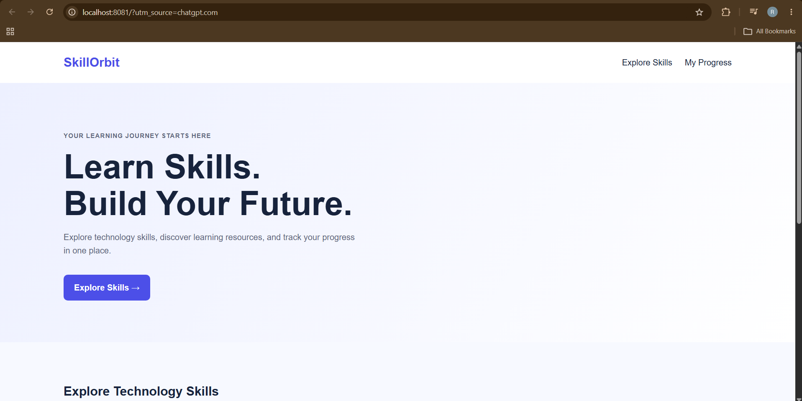
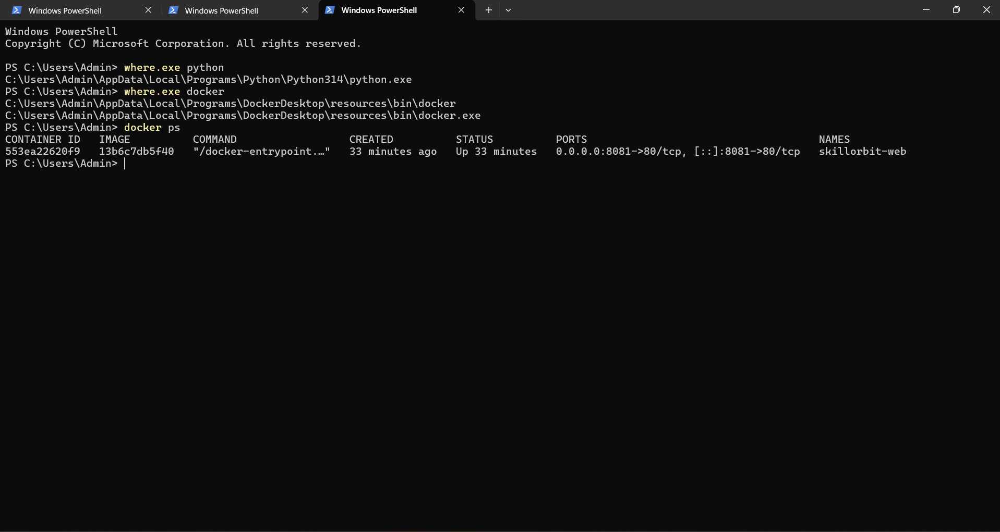
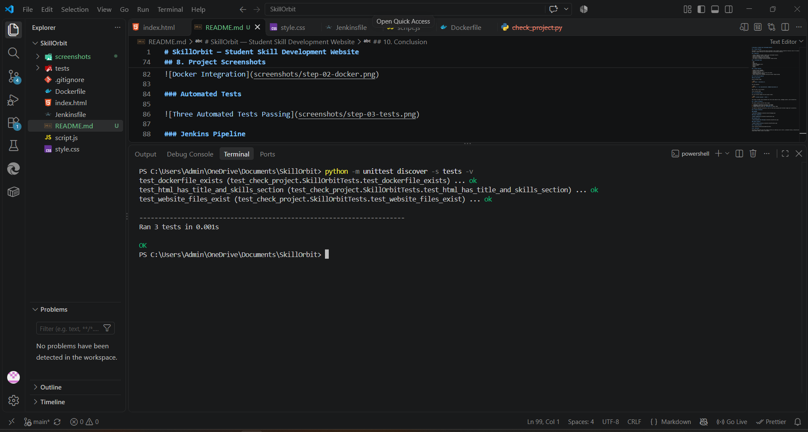
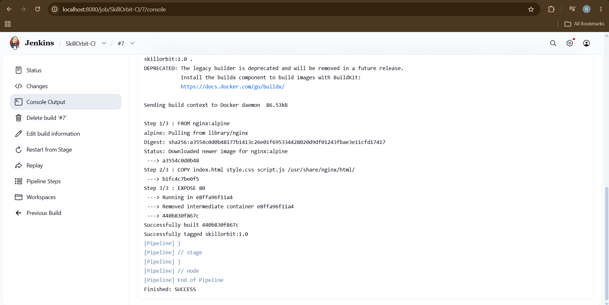

# SkillOrbit — Student Skill Development Website

## 1. Project Overview

SkillOrbit is a student-focused website designed to help students explore technical skills and learning resources for career preparation. It provides a simple, beginner-friendly interface for discovering skills, following learning roadmaps, tracking progress, and testing knowledge.

## 2. Objectives

- Create a beginner-friendly student skill development website.
- Organize technical skills and learning resources in one place.
- Use Git and GitHub for version control.
- Package and host the website using Docker.
- Automate testing and Docker image building using Jenkins.

## 3. Technologies Used

- HTML
- CSS
- JavaScript
- Python — automated testing
- Git and GitHub
- Docker
- Jenkins
- Nginx — web server

## 4. Project Features

- Student-focused homepage
- Technical skills exploration
- Learning roadmaps
- Learning progress tracker
- Interactive skills quiz
- Responsive website styling
- Automated checks for website files and homepage content
- Docker-based website hosting
- Jenkins pipeline for automated testing and Docker image building

## 5. How to Run the Website

### Prerequisites

Install Python, Git, and Docker Desktop. Ensure Docker Desktop is running.

### Run using Docker

Build the Docker image:

```bash
docker build -t skillorbit:1.0 .
```

Run the container:

```bash
docker run -d --name skillorbit-web -p 8081:80 skillorbit:1.0
```

Open the website in your browser:

http://localhost:8081

To stop the container:

```bash
docker stop skillorbit-web
```

### 6. Run Automated Tests

Run this command from the project folder:

```bash
python -m unittest discover -s tests -v
```

The project includes three automated tests that check the required website files, homepage content, and Dockerfile.

All three tests passed during verification.

## 7. Jenkins CI Pipeline

The Jenkins pipeline contains three stages:

1. **Checkout:** Retrieves the project source code from GitHub.
2. **Run Automated Tests:** Executes the Python unit tests.
3. **Build Docker Image:** Builds the `skillorbit:1.0` Docker image.

**Verification result:** The Jenkins pipeline completed successfully. All three automated tests passed, and the Docker image was built successfully.

## 8. Project Screenshots

### Homepage



### Docker Integration



### Automated Tests



### Jenkins Pipeline



## 9. GitHub Repository

[View the SkillOrbit source code on GitHub](https://github.com/Rutujasavalwade/SkillOrbit)

## 10. Conclusion

SkillOrbit demonstrates a basic DevOps workflow by combining source control, automated testing, containerization, and continuous integration. The project uses GitHub for source control, Python for testing, Docker for containerization, and Jenkins for pipeline automation.

The project can be extended in the future with user authentication, additional learning resources, deployment to a cloud platform, and more comprehensive automated tests.
